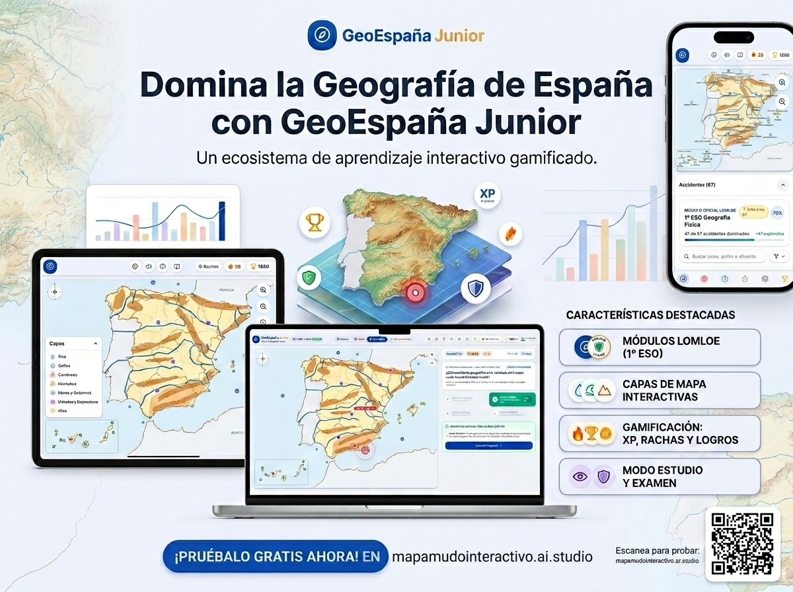

# 🗺️ GeoEspaña Junior (Versión 2.0): Mapa Mudo Interactivo & Retos de Geografía

> **Plataforma educativa gamificada y mapa mudo interactivo de España**, diseñada con rigor curricular para estudiantes de **1º y 2º de la ESO (12-14 años)**, Bachillerato, opositores y cualquier apasionado de la geografía física ibérica.

[](https://react.dev/)
[](https://www.typescriptlang.org/)
[](https://vitejs.dev/)
[](https://tailwindcss.com/)
[](https://educacion.gob.es/)
[](README.md)
[](LICENSE)

---

## 📸 Vista Previa de la Aplicación (v2.0)

<p align="center">
  
</p>

*Interfaz principal de GeoEspaña Junior v2.0: mapa físico vectorial con rosa de los vientos minimalista, balizas de identificación, buscador con filtro compacto y panel companion con métricas didácticas.*

---

## 📑 Tabla de Contenidos

1. [Novedades de la Versión 2.0](#-novedades-de-la-versión-20)
2. [Visión y Propósito Pedagógico](#-visión-y-propósito-pedagógico)
3. [Características Principales](#-características-principales)
4. [Modos de Juego](#-modos-de-juego)
5. [Mecánicas, Pistas y Puntuación](#-mecánicas-pistas-y-puntuación)
6. [Sistema de Gamificación y Progresión](#-sistema-de-gamificación-y-progresión)
7. [Cartografía y Capas Geográficas](#-cartografía-y-capas-geográficas)
8. [Generador de Fichas Imprimibles (Para Docentes)](#-generador-de-fichas-imprimibles-para-docentes)
9. [Configuración y Desacoplamiento (`gameConfig.ts`)](#-configuración-y-desacoplamiento-gameconfigts)
10. [Instalación y Despliegue](#-instalación-y-despliegue)
11. [Estructura del Proyecto](#-estructura-del-proyecto)
12. [Créditos y Licencia](#-créditos-y-licencia)

---

## 🚀 Novedades de la Versión 2.0

Esta segunda versión supone una evolución integral en precisión cartográfica, interactividad y experiencia pedagógica:

- 🗺️ **Nuevo Motor Cartográfico Vectorial (`spainBaseMapData` y `geographyAccidentsData`)**:
  - Trazo continuo y riguroso de la costa peninsular, límites fronterizos con Portugal, sur de Francia (franja pirenaica), norte de África (Marruecos y Estrecho de Gibraltar), Islas Baleares y recuadro cartográfico canario.
  - Polígonos de relieve adaptados a la orografía real: *Pirineos, Sistema Central, Sistema Ibérico, Cordillera Cantábrica, Montes de Toledo, Sierra Morena, Macizo Galaico, Montes de León, Montes Vascos, Cordillera Costero-Catalana* y desglose de las *Cordilleras Béticas* (*Subbética, Penibética y Sierra Nevada*).
  - Trazado hidrológico preciso para cada curso de agua según su vertiente (*Cantábrica, Atlántica y Mediterránea*).
- 🧭 **Rosa de los Vientos Minimalista**:
  - Nuevo diseño estilizado, funcional y de alto contraste con puntos cardinales N (rojo carmín), S, E (azul marino) y O, junto con rumbos secundarios (NE, SE, SO, NO).
- ⚡ **Renovación Completa del Modo 60s Contrarreloj**:
  - Dinámica de **preguntas relámpago Verdadero / Falso** (`¿Es este el...?`) con validación inmediata por teclado (`← Flecha Izquierda` para **SÍ**, `→ Flecha Derecha` para **NO**) o botones táctiles de gran tamaño.
  - Baliza interactiva con radar concéntrico animado y puntero vertical `¿ES ESTE?` señalando exactamente el accidente sobre el mapa mudo.
  - Desactivación limpia e instantánea del señalador en cuanto el tiempo se agota o termina la ronda.
  - Panel superior con monitor de **Aciertos**, **Fallos** (con icono distintivo rojo) y **Puntos XP**.
  - Bonificación de tiempo de **+2s por acierto** y penalización equilibrada de **-5 pts por fallo** (sin descender de 0).
- 🔍 **Buscador con Menú de Filtro Compacto**:
  - El selector de categorías se condensó en un desplegable elegante a la derecha del cuadro de búsqueda en el Atlas.
  - Icono dinámico con botón de limpieza directa (`FilterX` en color rojo) para descartar el filtro activo con un solo clic.
- 🎚️ **Sincronización Total de Capas y Estado Vacío**:
  - Al desactivar categorías desde el modal de capas, tanto la lista del explorador como los desafíos de juego y el generador de fichas impresas se filtran automáticamente a los elementos activos.
  - Si no hay elementos seleccionados, se presenta un estado visual pedagógico invitando al alumno a seleccionar contenidos.
- 📈 **Métricas de Racha Máxima (`maxStreak`) y Calificación Escolar**:
  - Registro de la racha actual y la mejor racha de la sesión.
  - Cálculo de calificación escolar sobre 10 (*Sobresaliente, Notable, Aprobado o Necesita Mejorar*).
- 🎖️ **Sello del Atlas Dinámico**:
  - La meta de exploración se calcula en tiempo real sobre la cantidad real de accidentes registrados (`GEO_ELEMENTS.length`), garantizando consistencia en todas las vistas y modales.

---

## 🎯 Visión y Propósito Pedagógico

El aprendizaje de la geografía física tradicionalmente ha sufrido de aridez memorística: memorizar listas de ríos, cordilleras y picos sin anclaje visual o espacial.

**GeoEspaña Junior** transforma este proceso en una **experiencia interactiva y motivadora**, combinando:
- **Cartografía vectorial precisa SVG** de la Península Ibérica, Islas Baleares y Archipiélago Canario.
- **Locución fonética por síntesis de voz (Web Speech API)** para aprender la pronunciación exacta de cada topónimo.
- **Gamificación estructurada** (experiencia, niveles, rachas, retroalimentación acústica e insignias).
- **Herramientas para docentes**: capacidad de silenciar etiquetas para exámenes de mapa mudo y generador de exámenes en papel A4 con clave de corrección.

---

## ✨ Características Principales

- 🗺️ **Mapa Mudo Vectorial Responsive**: Proyección cuidada con detalles del litoral, rías gallegas, golfos, cabos, ríos y sistemas montañosos.
- 🎨 **3 Temas Cartográficos**:
  - **Atlas Clásico**: Estilo pergamino cálido y pedagógico, ideal para proyectores escolares.
  - **Físico Moderno**: Relieve tridimensional con altitudes, tierras bajas y mares vivos.
  - **Nocturno / Satélite**: Modo oscuro de alto contraste (*gamer mode*) para evitar fatiga visual.
- 📚 **Catálogo de Accidentes Geográficos Curriculares**:
  - **Ríos Principales y Afluentes**: Vertiente Atlántica (Miño, Duero, Tajo, Guadiana, Guadalquivir), Vertiente Mediterránea (Ebro, Júcar, Segura, Turia, Ter, Llobregat) y Vertiente Cantábrica (Nalón, Navia, Bidasoa, Nervión).
  - **Cordilleras y Sistemas**: Pirineos, Sistema Central, Sistema Ibérico, Cordilleras Béticas (Subbética y Penibética), Sierra Nevada, Cordillera Cantábrica, Montes de Toledo, Sierra Morena, Montes de León, Montes Vascos, Macizo Galaico y Cordillera Costero-Catalana.
  - **Picos Más Altos**: Teide (3.718 m), Mulhacén (3.479 m), Aneto (3.404 m), Torre Cerredo, Moncayo, Almanzor...
  - **Costas y Accidentes Litorales**: Cabos (Finisterre, Gata, Creus, Palos, Peñas, Ajo, Trafalgar, Nao), Golfos (Vizcaya, Cádiz, Valencia, Rosas) y Rías Altas y Baixas.
  - **Archipiélagos e Islas**: Islas Canarias (Tenerife, Gran Canaria, Fuerteventura, Lanzarote, La Palma, La Gomera, El Hierro, La Graciosa) e Islas Baleares (Mallorca, Menorca, Ibiza, Formentera, Cabrera).
  - **Grandes Unidades de Relieve**: Meseta Central (Submeseta Norte y Sur), Depresión del Ebro y Depresión del Guadalquivir.
- 🔊 **Efectos de Audio y Voz**: Locución nativa en castellano y efectos sonoros espaciales para aciertos, fallos, rachas, subidas de nivel y confetti.
- 📱 **100% Adaptativo**: Optimizado para pizarras digitales interactivas (PDI), ordenadores portátiles, Chromebooks escolares, tablets y móviles.
- 🔒 **Privacidad Total (Zero Telemetry)**: Guarda el progreso localmente en el navegador (`localStorage`) sin recopilar datos personales de menores.

---

## 🎮 Modos de Juego

| Modo | Dinámica | Vidas / Tiempo | Objetivo Pedagógico |
| :--- | :--- | :--- | :--- |
| **📖 Atlas Interactivo** | Exploración libre sin cronómetro. Al pulsar sobre cualquier punto o buscar en la lista, se abre la ficha con fotos, altitud, vertiente, curiosidad histórica y pronunciación. | Ilimitado | Fase de estudio, descubrimiento guiado y repaso autónomo. |
| **🎯 ¿Dónde está? (Localizar)** | El sistema propone un accidente geográfico y el alumno debe hacer clic sobre su ubicación exacta en el mapa mudo. | 3 Vidas | Fijación de la memoria espacial y coordenadas relativas. |
| **🔍 Identificar (Quiz)** | Un accidente geográfico parpadea con la baliza fucsia `¿QUÉ ES?` en el mapa y se debe elegir la opción correcta entre 4 alternativas. | 3 Vidas | Reconocimiento topónimo-visual y descarte deductivo. |
| **⚡ Contrarreloj 60s** | Reto relámpago Verdadero/Falso con baliza `¿ES ESTE?`. Responde con teclado (`← Sí`, `→ No`) o botones táctiles. | 60s (+2s por acierto) | Automatización del conocimiento y reflejos rápidos. |

---

## 💡 Mecánicas, Pistas y Puntuación

El juego cuenta con un **sistema de puntuación balanceado** que premia la destreza individual pero garantiza que ningún estudiante se sienta frustrado ante una duda:

### 📊 Tabla de Puntos

| Modo de Juego | Acierto Directo | Acierto con Pista | Efecto Especial |
| :--- | :---: | :---: | :--- |
| **¿Dónde está?** | **+30 XP** | **+20 XP** *(Penalización de 10 pts)* | Centra el mapa e ilumina la región geográfica |
| **Identificar** | **+30 XP** | **+20 XP** *(Penalización de 10 pts)* | Ayuda 50/50: descarta 2 respuestas erróneas |
| **Contrarreloj 60s** | **+20 XP** | **+15 XP** *(Penalización de 5 pts)* | **+2 segundos extra** acumulados al reloj por acierto |
| **Atlas Interactivo** | **+10 XP** *(Por primer hallazgo)* | — | **+100 XP** y Sello Real al completar el catálogo |

### ⏱️ Bonificación de Tiempo en Contrarreloj (+2s)
En el modo Contrarreloj de 60 segundos, **cada respuesta acertada añade +2 segundos al cronómetro**, permitiendo a los jugadores expertos encadenar rachas de aciertos continuos.

### 💡 El Botón "Pedir Pista"
- Si un estudiante se bloquea en **¿Dónde está?**, puede pulsar **Pedir Pista**.
- El visor del mapa despliega una descripción orientativa para deducir la localización.
- Si acierta tras usar la pista, recibe una puntuación reducida pero positiva (20 pts en ¿Dónde está?, 15 pts en Contrarreloj).

### 🔥 Rachas de Aciertos Consecutivos y Racha Máxima
- Encadenar aciertos activa un multiplicador visual de llamas (`x2`, `x3`, `x4`...).
- Se registra tanto la racha en curso como la **Racha Máxima** de la partida, visible en el resumen de resultados.

---

## 🏆 Sistema de Gamificación y Progresión

### Rangos de Jugador
A medida que se acumula Experiencia (XP), el alumno asciende en la escala cartográfica:
1. **Novato de la Cartografía**: 0 – 99 XP
2. **Geógrafo Junior**: 100 – 249 XP
3. **Cartógrafo Aventurero**: 250 – 499 XP
4. **Gran Explorador de España**: 500 – 999 XP
5. **Catedrático de Geografía Ibérica**: 1.000+ XP

### Insignias y Logros Desbloqueables
- 🌊 **Maestro de Ríos**: Acierta 5 ríos de diferentes vertientes.
- 🏔️ **Conquistador de Cumbres**: Acierta 5 cordilleras o picos principales.
- 🏖️ **Centinela Costero**: Ubica 5 cabos, rías o golfos peninsulares.
- 🏝️ **Navegante Insular**: Demuestra dominio sobre Baleares y Canarias.
- ⚡ **Racha Imparable**: Consigue una racha continua de 5 aciertos sin fallos.
- 📜 **El Sello Dorado del Explorador**: Visita y consulta todos los accidentes en el Atlas Interactivo para estampar el pasaporte oficial con fuegos artificiales.

---

## 🗺️ Cartografía y Jerarquía de Capas

El panel de **Capas** permite configurar el mapa desde su contorno físico mudo más esencial hasta la división territorial provincial completa, además de seleccionar qué accidentes geográficos entran en los retos:

### 🏛️ Capas de Territorio y División Administrativa
- **🗺️ Capa 0: Contorno Geográfico Base (Siempre Activa)**: Silueta física continental continua de España peninsular, Portugal contiguo, el sur de Francia (franja pirenaica de Aquitania y Golfo de León), la costa norte de África (Marruecos y Estrecho de Gibraltar), Islas Baleares y el recuadro cartográfico de las Islas Canarias. Sin rótulos ni divisiones interiores: el auténtico mapa mudo.
- **🏛️ Capa 1: Comunidades Autónomas**: Conmutador para mostrar u ocultar las líneas fronterizas de las 17 Comunidades Autónomas y las 2 Ciudades Autónomas (Ceuta y Melilla).
- **📍 Capa 2: Provincias de España**: Conmutador para activar o desactivar la división de las 50 provincias españolas con trazo fino delimitador.
- **🏷️ Rótulos Didácticos**: Conmutador para alternar entre el modo de estudio con nombres visibles y el **Modo Mapa Mudo 100% puro** para autoevaluación o examen.

### ⛰️ Capas de Accidentes Geográficos Físicos
- 🌊 **Ríos**: Trazados hidrológicos vectoriales reales de las tres vertientes (*Cantábrica, Atlántica y Mediterránea*).
- 🏔️ **Cordilleras**: Áreas orográficas con relieves característicos vectorizados.
- ⛰️ **Picos**: Coordenadas exactas con triángulos altimétricos.
- 🏖️ **Costas**: Cabos, rías y golfos costeros señalizados.
- 🌊 **Mares y Océanos**: Océano Atlántico, Mar Cantábrico y Mar Mediterráneo.
- 🏝️ **Islas y Archipiélagos**: Comunidades insulares al completo.
- 🏞️ **Unidades de Relieve**: Mesetas y depresiones fluviales.

---

## 🖨️ Generador de Fichas Imprimibles (Para Docentes)

Pensado específicamente para el profesorado de Geografía e Historia en Secundaria:

1. Permite filtrar los accidentes que han entrado en la unidad didáctica.
2. Genera una vista lista para imprimir optimizada en **formato DIN A4** (tanto en blanco y negro para fotocopiadora como en color).
3. **Encabezado oficial**: Alumno/a, Grupo/Curso, Fecha y Calificación.
4. **Mapa con números aleatorios** y **tabla de respuestas** para rellenar a mano.
5. **Hoja de Soluciones**: El docente puede imprimir con un clic la clave de corrección con las soluciones numeradas para una corrección rápida.

---

## ⚙️ Configuración y Desacoplamiento (`gameConfig.ts`)

Todos los valores numéricos del juego están **estrictamente parametrizados y desacoplados del código** en el archivo [`src/constants/gameConfig.ts`](src/constants/gameConfig.ts).

Esto permite a cualquier profesor o desarrollador adaptar las reglas del juego en segundos:

```typescript
export const GAME_CONFIG = {
  POINTS: {
    LOCALIZAR_BASE: 30,
    LOCALIZAR_WITH_HINT: 20,
    CONTRARRELOJ_BASE: 20,
    CONTRARRELOJ_WITH_HINT: 15,
    IDENTIFICAR_BASE: 30,
    IDENTIFICAR_WITH_HINT: 20,
    CONTRARRELOJ_WRONG_PENALTY: 5,
    ATLAS_DISCOVERY_XP: 10,
    ATLAS_STAMP_BONUS_XP: 100,
  },
  TIMERS: {
    CONTRARRELOJ_INITIAL_SECONDS: 60,
    CONTRARRELOJ_TIME_BONUS_SECONDS: 2, // +2s por acierto en 60s
    CONTRARRELOJ_WARNING_SECONDS: 10,
    AUTO_ADVANCE_COUNTDOWN_SECONDS: 2,
  },
  GAMEPLAY: {
    INITIAL_LIVES: 3,
    DEFAULT_ROUND_SIZE: 20,
    MIN_PASSING_RATIO: 0.5,
    PERFECT_PASSING_RATIO: 1.0,
    LEVEL_XP_STEP: 100,
    STREAK_CELEBRATION_INTERVAL: 5,
  },
  // ...
} as const;
```

---

## 🚀 Instalación y Despliegue

### Requisitos Previos
- **Node.js** >= 18.0.0
- **npm** >= 9.0.0

### Pasos de Instalación

1. **Clonar el repositorio**:
   ```bash
   git clone https://github.com/tu-usuario/geoespana-junior.git
   cd geoespana-junior
   ```

2. **Instalar dependencias**:
   ```bash
   npm install
   ```

3. **Iniciar el servidor de desarrollo**:
   ```bash
   npm run dev
   ```
   Abre [http://localhost:3000](http://localhost:3000) en tu navegador.

4. **Verificar tipos y linting**:
   ```bash
   npm run lint
   ```

5. **Compilar para producción**:
   ```bash
   npm run build
   ```
   Los archivos estáticos optimizados se generarán en la carpeta `dist/`.

---

## 📁 Estructura del Proyecto

```text
├── src/
│   ├── assets/
│   │   └── images/              # Capturas y recursos gráficos de la aplicación
│   ├── components/
│   │   ├── Achievements/        # Modales de medallas, rangos y celebración del Sello
│   │   ├── Controls/            # Selector unificado de capas y filtros geográficos
│   │   ├── Explore/             # Panel del Atlas, buscador con menú compacto y fichas
│   │   ├── Manual/              # Modal interactivo del Manual del Juego y Guía Didáctica
│   │   ├── Map/                 # Mapa vectorial SVG (SpainMap) y Rosa de los Vientos (CompassRose)
│   │   ├── Navigation/          # Barra de navegación móvil inferior (MobileBottomNav)
│   │   ├── Printable/           # Generador de exámenes y fichas A4 con soluciones
│   │   ├── Quiz/                # Componente de desafíos (ChallengeMode), HUD y resultados
│   │   └── Header.tsx           # Barra superior con selector de modos, temas y controles
│   ├── constants/
│   │   └── gameConfig.ts        # Configuración centralizada de parámetros y constantes
│   ├── data/
│   │   ├── spainBaseMapData.ts  # Trazados vectoriales base: costas, fronteras, CCAA y provincias
│   │   ├── geographyAccidentsData.ts # Coordenadas y polígonos/trazos de accidentes
│   │   └── geographyData.ts     # Dataset completo con descripciones didácticas y curiosidades
│   ├── hooks/
│   │   └── useChallengeSession.ts # Máquina de estados desacoplada para los modos de juego
│   ├── types/
│   │   └── geography.ts         # Definiciones TypeScript de entidades y estados
│   ├── utils/
│   │   └── audio.ts             # Síntesis de sonido Web Audio y voz Web Speech
│   ├── App.tsx                  # Componente raíz y coordinación del layout responsive
│   ├── index.css                # Estilos globales y Tailwind CSS
│   └── main.tsx                 # Entrada de la aplicación React
├── public/                      # Recursos estáticos
├── metadata.json                # Metadatos del applet en AI Studio
├── package.json                 # Dependencias y scripts
├── README.md                    # Esta documentación
└── vite.config.ts               # Configuración del bundler Vite
```

---

## ♿ Accesibilidad y Rendimiento

- **Navegación accesible**: Compatibilidad con lectores de pantalla y etiquetas ARIA en todos los controles interactivos.
- **Atajos de teclado**: Soporte en el modo Contrarreloj con `←` para Sí y `→` para No.
- **Modo silencioso**: Interruptor de audio para aulas de informática o bibliotecas.
- **Cabecera colapsable**: Botón para minimizar la barra superior y aprovechar el 100% de la pantalla en dispositivos móviles y portátiles pequeños.
- **Rendimiento ligero**: Sin librerías pesadas de mapas externos; 100% SVG renderizado por el navegador con respuesta instantánea.

---

## 📄 Licencia

Este proyecto se distribuye bajo la licencia **Apache 2.0**. Puedes consultarla en el archivo [LICENSE](LICENSE).

---

<p align="center">
  Hecho con ❤️ para la enseñanza y el aprendizaje activo de la Geografía de España.<br>
  <strong>¡Que disfrutes explorando la Península y sus Islas! 🇪🇸</strong>
</p>
